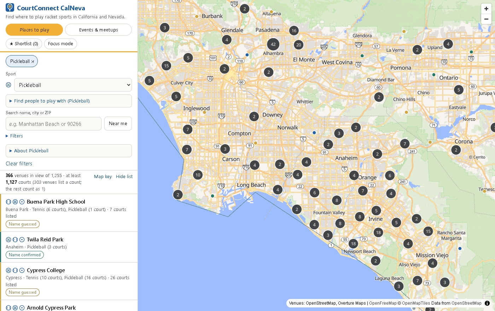
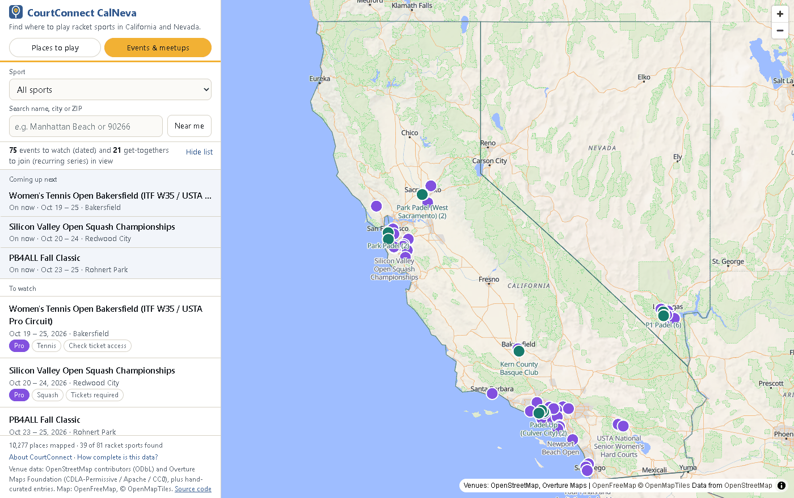
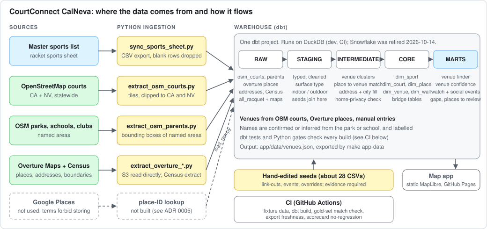

# CourtConnect CalNeva

**Find where to play, who to play with, and where to watch, for every racket sport in California and Nevada** ("CalNeva", [ADR 0014](docs/decisions/0014-calneva-scope.md)).

**[Open the live map](https://abov.github.io/courtconnect-ca/)** · [Data model and lineage (dbt docs)](https://abov.github.io/courtconnect-ca/dbt-docs/)

| Play | Watch |
|---|---|
|  |  |

*CourtConnect is a discovery tool for all racket sports: it finds where to play or watch, then sends you to the venue's or organizer's own site. It sells no tickets and takes no bookings or payments.*

Tennis, padel, pickleball and squash and dozens of lesser-known and up-and-coming racket sports are booming, but information about *where to play* is scattered and messy. Court finders each cover one sport, or only places you can book. This project is one free map of all of them, from free park courts and hitting walls to private clubs. It collects the data, cleans it, checks it, and says honestly how complete it is.

## Who it is for
- **Players:** find a court, filter by sport, surface and access, then follow link-outs to open play, leagues and lessons.
- **Curious players:** every sport on the master sheet is in one picker with an About card; sports with no place yet say so instead of faking pins.
- **Spectators:** dated pro and amateur events, each with the organizer's own link.
- **Clubs and organizers:** a free pin, an honest label, and a no-account way to fix or add a listing.
- **Researchers and builders:** one public JSON file, a data dictionary and an `llms.txt` ([below](#for-builders-and-ai-tools)).

Not offered, on purpose: bookings, payments, accounts, rankings or paid placement ([value proposition](docs/value_proposition.md), [product brief](docs/product_brief.md)).

## What it does
Live numbers (2026-10-23): **10,277 venues** (CA 9,732, NV 545), 1,650 confirmed, **39 of 82 sports** with at least one venue, 80 watch events, 21 social series, 923 hitting walls, 276 link-outs. By sport: [`docs/coverage_snapshot.md`](docs/coverage_snapshot.md).

- **Venue map** from OpenStreetMap, Overture Maps and hand-curated entries, with courts grouped into venues. Filter by sport, surface, indoor/outdoor, access, or search by name, city or ZIP; filters live in the URL.
- **Honest about confidence:** pins show how much to trust each name and sport (confirmed, business listing, inferred), and a **How complete is this data?** panel lists every sport, including those with no data.
- **Play / Watch / Social** views, plus a **hitting-wall** layer for solo practice ([ADR 0015](docs/decisions/0015-mission-and-social-phase.md)).
- **Link-outs** to a venue's own pages, each with a `verified_on` date and evidence note; popups show rules and access as the venue wrote them.
- **Phone-first:** bottom-sheet popup, **Near me** (location stays in the browser), dark mode, add to home screen; axe-core accessibility check passes in light and dark.
- **Market insights (inferred):** which sports are missing near a city and how many rival venues are nearby ([`docs/market_insights.md`](docs/market_insights.md)).
- **Quality checks:** dbt tests, a coverage report and a `make quality` scorecard with freshness SLAs ([`docs/data_quality.md`](docs/data_quality.md)).

## What the data showed
- **No single source is enough.** OSM knows where courts are, business listings know names; joining them is the product (27,493 OSM records plus Overture places became about 10,300 venues).
- **The map is mostly tennis.** Gaps are the story for lesser-known sports, so the app shows them instead of hiding them ([snapshot](docs/coverage_snapshot.md)).
- **Duplicates inflated the count.** Merging courts in one park and places at one address cut venues about 3%; a guard test now fails if two venues share a name within 150 m.
- **Most venues lacked a street address.** Now 4,291 show one (OSM tags, nearest Overture address or Nominatim, the last two labelled inferred) and every pin has a city; homes show the city only, by design ([ML plan](docs/ml_plan.md)).
- **Refreshing data does not fix a data gap; a different source does.** Pickleball hides on tennis courts and racquetball in gyms; city park pages, chain scans and owner reports found them ([gym scan](docs/gym_chain_scan.md)).
- **Websites go bad.** Links are checked and flagged (`make check-websites`), not trusted.

## ML strategy: small models suggest, people decide
Rule: **a model may rank or suggest; it never writes to the map.** Anything inferred is labelled. Full plan: [`docs/ml_plan.md`](docs/ml_plan.md).
- **Review-queue ranker (built):** logistic regression on 90 human labels orders uncertain sport matches (leave-one-out accuracy 86%, AUC 0.93).
- **LLM page reader (built, not run at scale):** every extracted field needs an exact quote that code checks is on the page; waits on an API key, spend cap and precision bar ([ADR 0017](docs/decisions/0017-llm-page-reader.md)).
- **Aerial-photo pilot:** finds courts but not sport or access, so it only leads people to fix OSM, not a data source.
- **Lesson:** check what a model learned, not just its score. Skewed labels taught the ranker "Tennis means reject" until real clubs were confirmed.

## How it fits together


| Stage | Where | Gate |
|---|---|---|
| Ingest | [`ingestion/`](ingestion) | `load_raw.py` refuses to shrink a table by more than 10% |
| Transform | [`transform/`](transform) | dbt tests, hand-labelled gold set for the place-to-court match |
| Ship | [`app/`](app), [`.github/workflows/`](.github/workflows) | CI on a fixture dataset, export freshness, scorecard no-regression |

Scale (measured 2026-10-28, Overture `2026-10-21.0`): the extracts query the 88M-place and 475M-address Overture parquet on S3 in place and fetch about 2% of those themes (743 MB of 39.6 GB); the data we keep is small. Method and caveats: [planet-scale benchmark](docs/planet_scale_benchmark.md).

No server or API: the map reads one exported file, `app/data/venues.json`. More: [architecture](docs/architecture.md), [tools and strategies](docs/tools_and_strategies.md), [case study](docs/case_study.md).

## Workflow and automation
- **Twice-monthly refresh:** sync sports, extract, load, fill addresses, build, export, quality scorecard, PR, CI, deploy ([runbook](docs/monthly_refresh.md)).
- **Suggest a change:** a form or issue, a reviewer adds the `approved` label, a GitHub Action opens a PR that edits one seed row, CI gates it, then merge ([ADR 0008](docs/decisions/0008-contributors-and-confirmation-workflow.md)).
- **Community reports:** a Google Form (no sign-in) or a GitHub issue; the owner approves, then `make sync-reports` imports it as a seed edit ([plan](docs/community_reports_plan.md), [`CONTRIBUTING.md`](CONTRIBUTING.md)).
- **Scheduled refresh, five gated agent runs:** on the 1st and 15th Claude Code scheduled tasks run Part 1 at 09:00 and Parts 2-5 at 10:30, 12:00, 13:30 and 15:00 (a scheduled run cannot start another task, so each part first checks that the previous one finished and skips itself if not). Each part is its own session (no subagents) with one job: (1) tennis, pickleball, ITF events, (2) badminton, racquetball, table tennis, squash, (3) padel calendar, beach tennis, padel lead rechecks, (4) Instagram sweep and player-group links, (5) the data refresh runbook with its quality gates. Parts 1-4 add to one tournament PR per cycle; Part 5 opens its own PR stacked on it. They read public pages only and record what they could not read. A merge gate (a script, not a model) merges the refresh PR by itself when it stays inside the R0 limits; tournament PRs are merged by a person, and re-date every event they re-confirm so the freshness SLA stays honest ([steps](docs/tournament_run_parts.md), [source runbook](docs/tournament_refresh.md), [refresh agent](docs/refresh_agent.md)).
- **Agent-assisted, gate-checked:** agents propose changes with evidence, automated gates verify them (dbt tests, CI, freshness, scorecard no-regression, diff cap, evidence required), and people still merge. The draft-mode refresh agent is the last link of the scheduled chain; a kind of change may auto-merge only after it has earned that and the owner switches it on ([ADR 0019](docs/decisions/0019-unattended-agent-merges.md), [plan](docs/self_service_plan.md), [`docs/refresh_agent.md`](docs/refresh_agent.md)).

**Skills shown:** SQL and dbt modelling with tests, entity resolution across messy sources, data-quality scorecards and freshness SLAs, CI/CD gates and GitHub Actions automation, small ML with leave-one-out validation, guard-railed LLM and agent workflows, written decision records ([ADRs](docs/decisions)), and scoping work by cost and risk (privacy, terms of use, honesty).

## For builders and AI tools
The map reads one public file, `app/data/venues.json` (about 2.4 MB, rebuilt about twice a month). Keys are single letters, so read the [data dictionary](app/data-dictionary.md) first; [`app/llms.txt`](app/llms.txt) is the short guide for AI tools. Both are published next to the map. A read-only MCP server over the file is proposed, not built ([ADR 0023](docs/decisions/0023-read-only-mcp-server.md)).

## Privacy and trust
- **No accounts, no cookies, no personal data.** Anonymous visit counts use GoatCounter (cookie-free, honours Do Not Track, counts only named events, never what a visitor typed; [ADR 0013](docs/decisions/0013-usage-analytics.md)).
- **Location stays in your browser** ("Near me" is never sent anywhere). Phone numbers are never exported; homes show the city only.
- **Nothing is invented:** inferred names, sports and addresses are labelled as inferred ([ADR 0007](docs/decisions/0007-confirmation-levels-and-leads.md)).
- **Open data only:** Overture and OSM, with attribution in the app ([`NOTICE.md`](NOTICE.md)).

## Quick start
```bash
pip install -r requirements.txt
make demo       # extract -> load -> build -> test (extract takes ~15 min)
make app-data   # export the map data
make app        # open http://localhost:8765
```
`make build` runs the dbt seeds, models and tests; it is the main check after any change to `transform/`. A new checkout without a database: `make fresh-db` (about a minute; loads the shared raw CSVs and runs the full build). On Windows, `view_db.bat` opens `courtconnect.duckdb` read-only in the DuckDB UI (close it before running dbt).

## Editing the data
Data lives in seeds under `transform/seeds/`; edit them, then `make build` and `make app-data`.

| To change | Edit |
|---|---|
| The list of sports | The Google Sheet, then `make sync-sports` (never hand-edit `all_racquet.csv`) |
| Add a venue no dataset knows | `manual_venues.csv` |
| Add a link-out (open play, lessons, ...) | `venue_actions.csv` |
| Add an event to watch | `watch_events.csv` |
| Confirm or reject an uncertain match | `place_sport_overrides.csv` |
| Mark an Overture place as closed | `closed_places.csv` (with evidence) |
| Correct a court count for one sport at a venue | `venue_court_counts.csv` (with evidence; add the missing sport via `manual_venues.csv`) |

Details: [`docs/data_guide.md`](docs/data_guide.md). Twice-monthly refresh routine: [`docs/monthly_refresh.md`](docs/monthly_refresh.md). Decisions: short records in [`docs/decisions/`](docs/decisions) (ADRs 0001 to 0026; 0001 is superseded by 0018; 0023 to 0026 are proposed).

## Principles
- **Honesty over polish:** inferred data is labelled as inferred.
- **Link out, never transact.**
- **Open data only:** Overture + OSM; Google Places is not used because its terms forbid storing it ([ADR 0005](docs/decisions/0005-overture-places-and-google-terms.md)).
- **Public pages only:** no use of anyone's logged-in accounts ([ADR 0007](docs/decisions/0007-confirmation-levels-and-leads.md)).
- Models run on **DuckDB** (Snowflake support retired 2026-10-14). Data licenses: [`NOTICE.md`](NOTICE.md).
- **Reusing it for another area or sport:** the covered region is one file, `ingestion/regions.json`; see the [fork guide](docs/fork_guide.md).

## Roadmap
Done:
- [x] Venue clustering, statewide extract, Overture second source, watch events, link-outs, suggest-a-change flow, duplicate guard
- [x] California + Nevada ([ADR 0014](docs/decisions/0014-calneva-scope.md)): 545 Nevada venues live; resort and casino courts closed by the owner (2026-10-17)
- [x] Street addresses and a city on every pin (OSM tags, nearest Overture address, Nominatim, Census boundaries; inferred ones labelled; homes show city only)
- [x] Every sheet sport in the dropdown (81), with About cards and blurbs; sports with no place yet are greyed "(none yet)" with a report-a-venue link, never fake pins ([`docs/sport_discovery_plan.md`](docs/sport_discovery_plan.md))
- [x] Padel kept apart from pop tennis, every Padel pin audited, directories swept, "Opening soon" pins ([`docs/padel_scan.md`](docs/padel_scan.md))
- [x] Social phase A: find people to play with (player-matching app links, Watch & Social view with recurring open-play series); anything further, such as own accounts, only after a separate decision ([ADR 0024](docs/decisions/0024-social-phase-b.md))
- [x] Visual polish PRs 1-6 (brand tokens, shape and motion, sport icons, friendlier states, popup grouping and status band, glyph pins), front-door promise lines and About dialog, Near me, add to home screen, axe accessibility pass
- [x] Market insights v1, `llms.txt` and a data dictionary, extra analytics events, a draft-mode refresh agent
- [x] Phone and accessibility follow-ups: 44 px touch targets, a tick / "?" badge on zoomed pins so status does not rely on colour, Near me distances (nearest-first lists), better glyph and chip contrast, and a computed "(north courts, 6 courts)" suffix that tells apart venues sharing an inferred name
- [x] Load time measured on throttled Slow 4G / Fast 3G: fine for the beta ([`docs/sessions/2026-10-23-load-time.md`](docs/sessions/2026-10-23-load-time.md))

Next, in order (details in [`CLAUDE.md`](CLAUDE.md) "Open, in order"):
- [ ] Beta prep (owner): exclude your own visits in GoatCounter on each device, then send the invites
- [ ] Beta feedback round with friends (December; [`docs/feedback_round.md`](docs/feedback_round.md)), then rank what to build with the findings
- [ ] Facility scans (UC and CSU campuses, military MWR) and club-named venues, one family at a time
- [ ] Prove the scheduled chain end to end on a real 1st/15th run (five staggered crons, each gated on the previous part), then watch spend against the $20/month ceiling
- [ ] Review queue (116 rows, parked: needs the page reader or community reports) and ML phase 2-3 (Claude page-reader run waits on an API key, a spend cap and a precision bar; the aerial pilot is not worth scaling, [`docs/ml_plan.md`](docs/ml_plan.md))
- [ ] After the beta: cost tier, Watch events split on-site vs screening ([ADR 0022](docs/decisions/0022-watch-event-format-split.md)), optional read-only MCP server ([ADR 0023](docs/decisions/0023-read-only-mcp-server.md))
