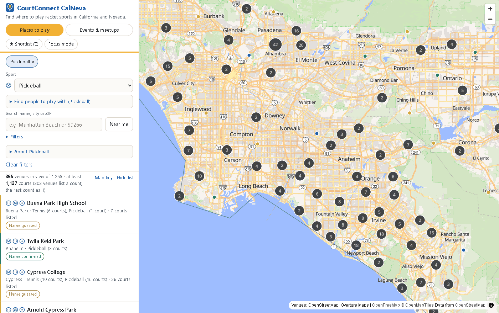
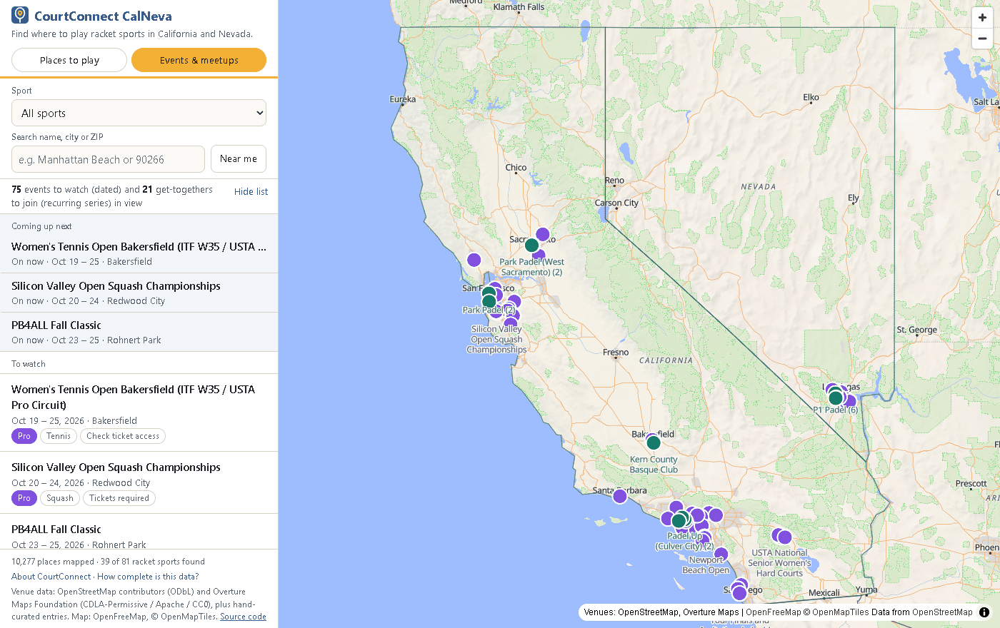

# RacketConnect

**Find where to play, who to play with, and where to watch, for every racket sport in California, Nevada, Oregon, Washington, Arizona, New Mexico, Texas, Hawaii and parts of Mexico** (scope: [ADR 0014](docs/decisions/0014-ca-nv-scope.md), growing in [ADR 0028](docs/decisions/0028-five-state-scope.md)).

**[Open the live map](https://abov.github.io/courtconnect-ca/)** · [How it's built and all the docs](https://abov.github.io/courtconnect-ca/how-its-built.html#docs) · [Data quality (live)](https://abov.github.io/courtconnect-ca/dashboard/)

| Play | Watch |
|---|---|
|  |  |

*A discovery tool for all racket sports: it finds where to play or watch, then sends you to the venue's or organizer's own site. It sells no tickets and takes no bookings or payments.*

Information about *where to play* tennis, padel, pickleball, squash and dozens of lesser-known racket sports is scattered and messy. RacketConnect is one free map of all of them, from park courts and hitting walls to private clubs. It collects the data, cleans it, checks it, and says honestly how complete it is.

- **Every place and every racket sport,** not only bookable clubs or one sport ([how it differs](docs/competitor_scan.md)).
- **Honest labels:** each fact is marked official, reported or inferred, with dates ([ADR 0007](docs/decisions/0007-confirmation-levels-and-leads.md)).
- **Links out, never bookings or payments.**

## Where to read more
**Start at the [project hub](docs/README.md)**: every live page, dashboard, tool, account and doc in one list (a CI check keeps it complete). The live site keeps the story and numbers current without hand edits here:
- **[How it's built](https://abov.github.io/courtconnect-ca/how-its-built.html)**: pipeline, gates, measured numbers and what is not measured yet.
- **[Documentation index](https://abov.github.io/courtconnect-ca/how-its-built.html#docs)**: case study, architecture, decisions (ADRs), costs, runbooks, data dictionary.
- **Dashboards and metrics** (data quality, pipeline health, uptime, usage, delivery speed and conflicts): [one table in the hub](docs/README.md#metrics-and-monitoring-every-view-one-table).
- **[Ask the data](https://abov.github.io/courtconnect-ca/ask-the-data.html)**: SQL on the public venue file, in your browser.
- Builders and AI tools: `app/data/venues.json` with a [data dictionary](app/data-dictionary.md) and [`llms.txt`](app/llms.txt).
- Status and next steps: [`docs/status.md`](docs/status.md). Tools and accounts: [hub](docs/README.md#2-source-tools-and-accounts).

**Stack:** Python ingestion, a tested dbt project on DuckDB, a static MapLibre page on GitHub Pages. No server, no accounts, no cookies; location for "Near me" stays in the browser, phone numbers are never exported and homes show the city only. Map data from OpenStreetMap and Overture Maps ([`NOTICE.md`](NOTICE.md)).

## Quick start
```bash
pip install -r requirements.txt
make demo       # extract -> load -> build -> test (extract takes ~15 min)
make app-data   # export the map data
make app        # open http://localhost:8765
```
`make build` runs the dbt seeds, models and tests; it is the main check after any change to `transform/`. A new checkout without a database: `make fresh-db` (about a minute; loads the shared raw CSVs and runs the full build). On Windows, `view_db.bat` opens `courtconnect.duckdb` read-only in the DuckDB UI (close it before running dbt).

## Build the database from scratch
You do not need a copy of anyone's `courtconnect.duckdb`, and the raw data is not stored in this repo (`data/raw` is gitignored). The database is rebuilt from public sources:
```bash
pip install -r requirements.txt
make extract          # OSM (Overpass) + Overture places; ~15-20 min, public sources only
make extract-boundaries extract-addresses   # Census boundaries + Overture address points
make load             # raw CSVs -> DuckDB
make build            # dbt seeds + models + tests -> courtconnect.duckdb
```
Shortcut with no extract: once a data bundle is published as a GitHub Release, `make fetch-data` (`ingestion/fetch_data_bundle.py`, `--repo` for a fork) downloads it into `data/raw`, then `make fresh-db`. The maintainer builds the bundle with `python ingestion/make_data_bundle.py`. `make demo` runs extract, load and build in one go. If you already have the raw CSVs in `data/raw` (or a folder named by `COURTCONNECT_DATA_DIR`), `make fresh-db` rebuilds the database in about a minute. To try changes without a long extract, `python ingestion/load_raw.py --data-dir ci/fixtures` then `make build` uses the small sample set CI builds from. The `.duckdb` file is a build output and is never committed.

## Editing the data
Data lives in seeds under `transform/seeds/`; edit them, then `make build` and `make app-data`.

| To change | Edit |
|---|---|
| The list of sports | The Google Sheet, then `make sync-sports` (never hand-edit `all_racquet.csv`) |
| Add a venue no dataset knows | `manual_venues.csv` |
| Add a link-out (open play, lessons, ...) | `venue_actions.csv` |
| Add an event to watch | `watch_events.csv` |
| Confirm or reject an uncertain match | `place_sport_overrides.csv` |
| Mark an Overture place as closed | `closed_places.csv` (with evidence) |
| Correct a court count for one sport at a venue | `venue_court_counts.csv` (with evidence; add the missing sport via `manual_venues.csv`) |

Details: [`docs/data_guide.md`](docs/data_guide.md). Twice-monthly refresh routine: [`docs/monthly_refresh.md`](docs/monthly_refresh.md). Decisions: short records in [`docs/decisions/`](docs/decisions).

## Principles
- **Honesty over polish:** inferred data is labelled as inferred.
- **Link out, never transact.**
- **Open data only:** Overture + OSM; Google Places is not used because its terms forbid storing it ([ADR 0005](docs/decisions/0005-overture-places-and-google-terms.md)).
- **Public pages only:** no use of anyone's logged-in accounts ([ADR 0007](docs/decisions/0007-confirmation-levels-and-leads.md)).
- Models run on **DuckDB** (Snowflake support retired 2026-10-14). Data licenses: [`NOTICE.md`](NOTICE.md).
- **Reusing it for another area or sport:** the covered region is one file, `ingestion/regions.json`; see the [fork guide](docs/fork_guide.md).
